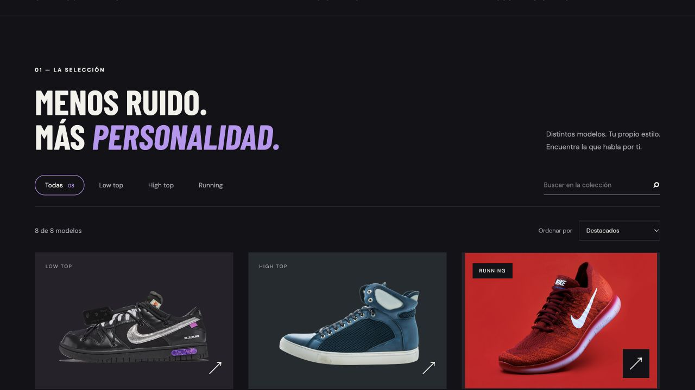
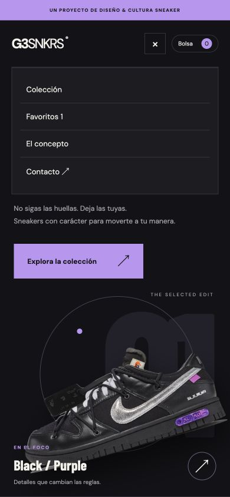

# 👟 G3SNKRS

### Sneakers, estilo urbano y un poco de código :)

Mi proyecto de **Lenguaje de marcas — DAW**: una tienda de zapatillas con estética oscura y detalles morados. Puedes mirar el catálogo, guardar tus pares favoritos y probar todo el recorrido de compra.

**HTML · CSS · JavaScript** — sin frameworks ni instalaciones raras 🤝

## 📸 Así se ve



<details>
<summary>📱 Ver el menú en móvil</summary>



</details>

## 🔥 Qué puedes hacer

- 👟 Explorar los **8 modelos** y abrir sus fichas.
- 🔎 Buscar zapatillas, filtrar por tipo y ordenar por precio o nombre.
- 💜 Guardar favoritos y volver a verlos al abrir la página.
- 📏 Consultar una guía de tallas orientativa.
- 🛍️ Añadir productos con su talla, quitarlos o vaciar la bolsa.
- 📦 Probar una compra con formulario, envío estándar o exprés y confirmación.
- 📱 Usarla en móvil con su menú desplegable.

> 🧪 Es una demo para clase. Aquí se prueban pedidos, no se gastan euros: **no hay cobros, envíos ni compras reales**. Tampoco se piden tarjetas.

## 🚀 Para abrirla

Descarga el repositorio y abre **`index.html`**. Ya está, sin más vueltas.

Si prefieres usar un servidor local, ejecuta esto desde la carpeta del proyecto:

```sh
python3 -m http.server 8000
```

Después entra en **http://localhost:8000**.

## 🗂️ Dónde está cada cosa

| Archivo | Qué lleva |
| --- | --- |
| `index.html` | La estructura, secciones y formularios |
| `styles.css` | El diseño y la adaptación a móvil |
| `catalogo.js` | Los modelos, fotos, precios y descripciones |
| `app.js` | Filtros, favoritos, bolsa y compra de prueba |
| `assets/` | Imágenes de las zapatillas y favicon |
| `docs/` | Capturas para este README |
| `CREDITOS.md` | Procedencia de las imágenes |

## 🛠️ Para añadir más zapatillas

1. Guarda la imagen en `assets/`.
2. Añade un producto en `catalogo.js` con un `id` que no se repita.
3. Rellena el nombre, foto, precio, descripción y categoría: `low`, `high` o `running`.
4. Si es una foto con fondo, añade `fotografia: true`.

El contador de modelos se actualiza solo 👌

## 🛒 Cómo va la compra de prueba

Elige un par y su talla → abre la bolsa → pulsa **Tramitar pedido de prueba** → completa el formulario con **datos ficticios** → confirma.

El envío estándar suma **5 €** y el exprés **10 €** al total de ejemplo. Al terminar aparece una referencia de prueba y se vacía la bolsa.

La bolsa y los favoritos se guardan en el navegador con `localStorage`. Los datos del formulario **no se envían ni se guardan**: se borran al cerrar o confirmar la compra.

## 🌍 GitHub Pages

Para publicar la web: **Settings → Pages → Deploy from a branch → main → / (root) → Save**.

## 📷 Imágenes y créditos

Las fotografías son recursos de muestra. Los nombres de la colección y los precios son de ejemplo, y las tallas son orientativas. La procedencia de las imágenes está en [CREDITOS.md](CREDITOS.md). No es una tienda oficial de las marcas que aparecen.

---

**G3SNKRS · Proyecto Lenguaje de marcas 👟💜**
